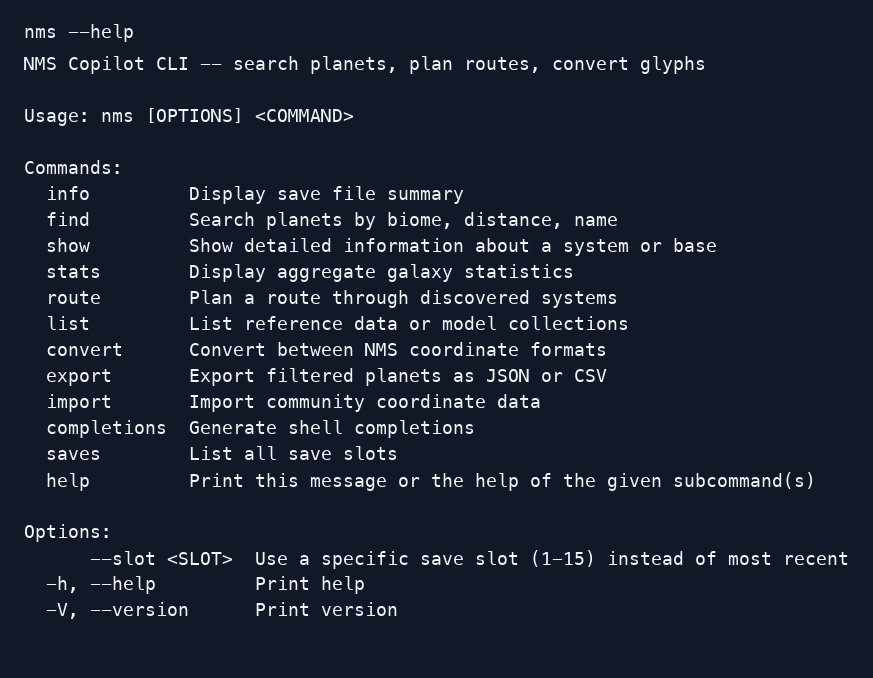
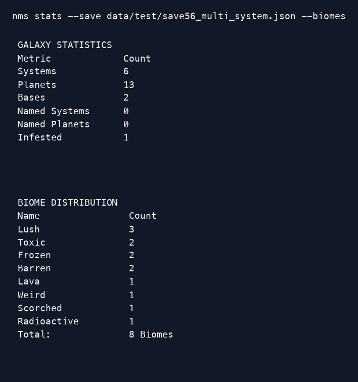

# 🚀 NMS Copilot

[![][build-badge]][build]
[![][crate-badge]][crate]
[![][tag-badge]][tag]
[![][docs-badge]][docs]
[](#license)

**A real-time galactic copilot for [No Man's Sky](https://www.nomanssky.com/), built in Rust.**

[![][logo]][logo-large]

Search planets by biome. Plan warp routes through the stars. Convert portal glyphs with emoji. Watch your save file live as you play — and let an AI explore the galaxy *with* you.

The following is illustrative REPL command and output.

```text
[Euclid │ 644 planets │ 293 systems] 🚀 find --biome Lush --nearest 5

  #  Planet            Biome   System             Distance   Portal Glyphs
  1  Metok-Kalpa       Lush    Gugestor Colony       0 ly    🌅🕊️🐜🕊️🐜🌳🦋🕋🌜🔺🕋😑
  2  Sushimi           Lush    Esurad               18K ly   🌅🕊️🐜🦕🌜🎈⛵🐜🦋🌀🕋🐋
  3  (unnamed)         Lush    Ogsjov XV            42K ly   🌅😑🐜🕊️🐜🌳🌜🕋🌅🔺🕋🦕
  4  (unnamed)         Lush    Rastarc-Zukk         67K ly   🌅🦕🐜🕊️🐜🌅🦋🕋🌜🔺🕋🐜
  5  Dipadri Grosso    Lush    Ipswic               91K ly   🌅🌜🐜🕊️🐜🌳🌜🕋🌅🌀🕋😑
```

---

## What is this?

NMS Copilot reads native `save.hg` files and supported JSON input, then builds
an in-memory model of discovered systems, planets, and bases. It is not a save
editor; it is a **queryable atlas**. Start with an explicit save path or the
committed synthetic fixture shown below so commands do not need to discover a
save on your machine.

Two ways to use it:

| Interface | What it does |
|-----------|-------------|
| **CLI** (`nms`) | One-shot commands for quick lookups and scripted pipelines |
| **REPL** (`nms-copilot`) | Interactive session with persistent state, built-in MCP server for AI co-exploration |

In normal REPL mode, the copilot can watch the selected save for changes and
update its model. The built-in MCP server observes that shared live model. Save
watching is configurable and can be disabled; the details appear below.

Use `--headless` to run just the MCP server without the REPL (e.g., for Claude Desktop integration).

### Try the committed synthetic save

With Rust 1.91 or later installed, run these commands from the repository root.
They pass the fixture path explicitly and do not inspect your game-save
directories:

```bash
cargo run -p nms-cli --bin nms -- info --save data/test/save56_multi_system.json
cargo run -p nms-cli --bin nms -- stats --save data/test/save56_multi_system.json --biomes
```

The fixture is synthetic test data, not a copy of a player's save. For your own
data, pass a path with `--save`; the application reads save data and does not
edit it.

The documentation set includes monochrome rendered views of the real CLI help
and fixture statistics output. Recognized ANSI styling is omitted only from
image presentation; the complete raw text remains unchanged. These are rendered
CLI captures, not desktop screenshots. The text and images below come from the
captured commands described in [the capture notes](docs/captures/README.md):





See [the capture notes](docs/captures/README.md) for their source commands and
rendering method.

---

## Features

- **Native save file parsing** -- reads `save.hg` directly (LZ4 block decompression + JSON key deobfuscation), no export step needed
- **Planet search** -- find planets by biome, distance, discoverer, infested status, or any combination
- **Route planning** -- nearest-neighbor and 2-opt TSP solvers with warp-range hop constraints
- **Portal glyph converter** -- fully multidirectional: hex, emoji, coordinates, signal booster, galactic address
- **Interactive galaxy map** -- full-screen TUI with galaxy, region, and local zoom levels
- **Live file watching** -- detects auto-saves while you play and updates the model in real time
- **rkyv cache** -- zero-copy serialization for near-instant startup after the first load
- **Multi-save support** -- switch between save slots (up to 15)
- **Export & import** -- JSON/CSV export of filtered data; CSV import of community coordinates
- **MCP server** -- stdio and HTTP transports for AI copilot integration (Claude Desktop, etc.)
- **Built-in terminal palettes** -- table colors follow the selected header style; the configuration file does not expose palette settings. `[display].color` controls startup banner color.
- **Shell completions** -- bash, zsh, fish, powershell, elvish
- **Multi-galaxy routing** -- per-galaxy spatial indexes across all 256 NMS galaxies

---

## Portal Glyphs

NMS Copilot renders portal addresses as emoji throughout all interfaces:

Portal Glyphs

| Index | Name  |      Hex | Emoji | Unicode|
|-------|-------|----------|-------|--------|
|  0 |   Sunset  |     0 |  🌅  |   U+1F305
|  1 |   Bird    |     1 |  🕊️  |   U+1F54A U+FE0F
|  2 |   Face    |     2 |  😑  |   U+1F611
|  3 |   Diplo   |     3 |  🦕  |   U+1F995
|  4 |   Eclipse |     4 |  🌜  |   U+1F31C
|  5 |   Balloon |     5 |  🎈  |   U+1F388
|  6 |   Boat    |     6 |  ⛵  |   U+26F5
|  7 |   Bug     |     7 |  🐜  |   U+1F41C
|  8 |   Dragonfly|    8 |  🦋  |   U+1F98B
|  9 |   Galaxy   |    9 |  🌀  |   U+1F300
| 10 |   Voxel    |    A |  🕋  |   U+1F54B
| 11 |   Whale    |    B |  🐋  |   U+1F40B
| 12 |   Tent     |    C |  ⛺  |   U+26FA
| 13 |   Rocket   |    D |  🚀  |   U+1F680
| 14 |   Tree     |    E |  🌳  |   U+1F333
| 15 |   Atlas    |    F |  🔺  |   U+1F53A

Convert freely between formats:

```bash
# Emoji → coordinates
nms convert --glyphs "🌅🕊️🐜🕊️🐜🌳🦋🕋🌜🔺🕋😑"

# Hex glyphs → coordinates
nms convert --glyphs 01717D8A4EA2

# Signal booster → emoji glyphs
nms convert --coords 0EA2:007D:08A4:0171

# Galactic address → everything
nms convert --ga 0x40050003AB8C07
```

---

## Commands

The CLI (`nms`) and interactive REPL (`nms-copilot`) share `find`, `show`,
`stats`, `route`, `convert`, and `list`. For commands that read a save, the CLI
accepts `--save` or `--slot`; the REPL operates on its already loaded model and
has no save-path flag. CLI-only commands include `saves`, `export`, `import`,
and `completions`. The `info` command is available in both interfaces: CLI
`info` summarizes the selected save, while REPL `info` reports loaded model
counts and the physical current position. REPL session anchors and settings
appear under `status`. REPL-only commands are listed in the REPL section.

### Search

Find planets matching any combination of criteria, sorted by distance:

```bash
nms find --biome Lush                          # all lush planets
nms find --biome Scorched --infested           # infested scorched only
nms find --biome Barren --within 100000        # within 100K ly
nms find --biome Lava --nearest 5              # 5 closest lava planets
nms find --biome Swamp --from "Sealab 2038"   # distance from a named base
nms find --named --discoverer oubiwann         # your named discoveries
```

### Route Planning

Plan heuristic routes through discovered systems with warp-range constraints.
The nearest-neighbor and 2-opt algorithms are route heuristics, not guarantees
of a globally shortest route:

```bash
nms route --biome Scorched --algo nn             # visit all scorched, nearest-neighbor
nms route --biome Scorched --within 500000       # only within radius
nms route --biome Lush --warp-range 2500         # S-class hyperdrive hops
nms route --biome Frozen --algo 2opt             # improved TSP
nms route --target "Base A" --target "Base B"    # explicit waypoints
nms route --biome Lush --round-trip              # return after visiting Lush targets
```

### CLI Save Summary & Details

```bash
nms info                              # save-file overview and discovery counts
nms show system 369                   # system details + all planets
nms show base "Acadia National Park"  # base details with portal glyphs
nms stats --biomes                    # overview and available biome distribution
nms stats --discoveries               # currently the same overview/biome output
nms saves                             # list discovered save slots
```

### Coordinate Conversion

```bash
nms convert --glyphs 01717D8A4EA2                  # hex glyphs to all formats
nms convert --glyphs "🌅🕊️🐜🕊️🐜🌳🦋🕋🌜🔺🕋😑"  # emoji glyphs to all formats
nms convert --coords 0EA2:007D:08A4:0171           # signal booster format
nms convert --ga 0x40050003AB8C07                   # galactic address
nms convert --voxel 100,50,-200 --ssi 42           # voxel coordinates
```

### Export & Import

`nms export` writes a flat twelve-field planet record to stdout as JSON (the
default) or CSV. Its fields, in order, are `planet_name`, `biome`,
`system_name`, `distance_ly`, `portal_glyphs`, `portal_emoji`, `coords_x`,
`coords_y`, `coords_z`, `galaxy`, `discoverer`, and `infested`. The default
reference is the current position in the current galaxy. It accepts the shared
biome, infested, named-planet, discoverer, distance, nearest, and base-reference
filters. A base reference selects that base's galaxy; each row's portal address
and coordinates come from the stored system address. Export does not modify
the save. Input and query errors go to stderr before a data payload is written.
An empty CSV result is zero bytes.

```bash
nms export --format json                          # export all matching planets as JSON
nms export --biome Lush --format csv              # export filtered planets as CSV
nms import community_data.csv --source "NMSCE"    # import community coordinates
```

The import command reads a community coordinate CSV into its one-shot in-memory
query model. `--source` is retained exactly as the contribution label, including
spacing and Unicode. New accepted systems and marked player-placeholder
promotions are tagged `Community { source }`; existing genuine systems are left
unchanged when a later row matches them. A later source does not merge or replace
the first genuine contribution. This origin is separate from `DM.CN` display
names and the in-game discoverer. Import reports its counts on stderr and does
not write the save or cache; there is no REPL import command. To reuse the data,
run the import again for that session.

Rust callers can inspect `System.source` (`Personal` or
`Community { source: String }`). Ordinary save extraction creates `Personal`
systems. The existing whole-model cache stores this tag; cache schema 4 /
semantic 6 is required for that added field and meaning. Older schema 3 /
semantic 5 caches have no source field, so their origin cannot be inferred from
labels. They are rejected and rebuilt from the save as `Personal`; imported
cache-only systems must be imported again. Export remains the existing flat
twelve-field contract and does not include contribution source.

### Listing Data

Browse reference data and model collections:

```bash
nms list galaxies                      # all 256 galaxies
nms list galaxies --type Lush          # filter by galaxy type
nms list biomes                        # biome types and variants
nms list glyphs                        # portal glyph table
nms list terrain-types                 # terrain generation types
nms list bases                         # all player bases
nms list systems --limit 10            # first 10 discovered systems
nms list systems --all                 # all discovered systems
```

### Shell Completions

The `completions` command generates scripts for Bash, Zsh, Fish, PowerShell, and Elvish. Generating a script requires only `nms`; using it requires the matching shell.

For Bash, save the script and load it into the current shell:

```bash
mkdir -p "$HOME/.bash_completion.d"
nms completions bash > "$HOME/.bash_completion.d/nms"
source "$HOME/.bash_completion.d/nms"
```

To load it in future Bash sessions, add this line to `~/.bashrc`:

```bash
source "$HOME/.bash_completion.d/nms"
```

For Zsh, generate `_nms` in a directory on `fpath`:

```zsh
mkdir -p "$HOME/.zfunc"
nms completions zsh > "$HOME/.zfunc/_nms"
```

Add the `fpath` assignment to `~/.zshrc` before its existing `compinit` call. If your configuration does not initialize completion yet, add the setup once:

```zsh
fpath=("$HOME/.zfunc" $fpath)
autoload -Uz compinit
compinit
```

For Fish, save the script in its standard completion directory. Fish loads it automatically in future sessions:

```fish
mkdir -p "$HOME/.config/fish/completions"
nms completions fish > "$HOME/.config/fish/completions/nms.fish"
```

### Multi-Save Support

The CLI discovers the canonical `save.hg` and `save2.hg` through `save30.hg`
files as slots 1–15. Use `--slot N` to select the most recent manual or auto
save in that slot from the first name-sorted account. An empty account or
missing slot does not fall through to a later account. Within a selected
slot, the manual save wins an equal-mtime tie. Without `--slot`, commands use
the most recently modified save across accounts. When both `--save` and
`--slot` are supplied, the explicit `--save` path takes precedence. `nms saves`
lists the discovered accounts and their manual/auto slot files.

```bash
nms info --slot 3                   # use save slot 3 instead of most recent
nms find --slot 5 --biome Lush      # search slot 5's discoveries
```

### Interactive REPL

The REPL (`nms-copilot`) provides the shared query commands over its loaded
model, plus session management and an interactive galaxy map. The following is
illustrative REPL command and output:

```text
nms-copilot

[Euclid | 644 planets] 🚀 set position "Acadia National Park"
📍 Position set to Acadia National Park (Lush, Gugestor Colony)

[Euclid | 644 planets] 🚀 find --biome Lava --nearest 3
  #  Planet       Biome  Distance   Portal Glyphs
  1  (unnamed)    Lava     127K ly  🌅🦕🌀🕊️🐜🌳🌜🕋🌅🌀🕋🦕
  2  (unnamed)    Lava     204K ly  🌅🌜🐜🕊️🐜🌳🦋🕋🌜🔺🕋😑
  3  (unnamed)    Lava     318K ly  🌅😑🐜🕊️🐜🌅🌜🕋🌅🔺🕋🐜

[Euclid | 644 planets] 🚀 list bases --limit 5
  #  Base                    System            Planet          Biome
  1  Acadia National Park    Gugestor Colony   Metok-Kalpa     Lush
  2  Sealab 2038             Esurad            Sushimi         Lush
  ...

[Euclid | 644 planets] 🚀 map
  (opens full-screen interactive galaxy map with zoom levels)

[Euclid | 644 planets] 🚀 galaxy
Active galaxy: Euclid (0)
Discovered galaxies: Euclid (0), Eissentam (9)

[Euclid | 644 planets] 🚀 galaxy Eissentam
Switched to Eissentam (galaxy 9). <systems> systems loaded.

[Eissentam | 644 planets] 🚀 galaxy "Hilbert Dimension"
```

`galaxy` selects a view and does not move the traveller. Galaxy indices from 0
through 255 and quoted multi-word names are accepted. A default follow-player
`find` or `route` reports the existing reference/active galaxy mismatch when
the selected view differs from the physical location. Set a base reference
with `set position "Camp-9"` or provide `--from "Camp-9"`. Explicit base and
address references keep their own galaxy if the selected view later changes.

REPL-only commands:

| Command | Description |
|---------|-------------|
| `galaxy [index-or-name]` | Show discovered galaxies or select the galaxy view. |
| `set position <base>` | Set reference position for distance calculations |
| `set biome <biome>` | Set default biome filter for find/route |
| `set warp-range <ly>` | Set default warp range for route planning |
| `reset [position\|biome\|warp-range\|all]` | Reset session state |
| `status` | Show current session state |
| `last` | Show the last successful query response from this REPL session. It is a snapshot and is not refreshed. |
| `map` | Interactive galaxy map (galaxy/region/local zoom) |
| `help` | Show REPL help. |
| `exit`, `quit` | End the REPL session. |

The REPL's `info` command reports loaded model counts and the physical current
position. Use `status` for session anchors and settings; CLI `info` summarizes
a selected save file.

`last` recalls the rendered response from the most recent successful `find`,
`show`, `stats`, or `route` command in the current REPL session. The response
keeps its original formatting and is not refreshed after live model updates;
query errors and other commands leave it unchanged. A new session starts with
no saved query response.

---

## Architecture

NMS Copilot is a Rust workspace of focused crates:

```
nms/
├─ nms-core       Types, enums, address math, glyph emoji
├─ nms-save       Raw binary save parser (LZ4 + XXTEA + key mapping)
├─ nms-compat     JSON compatibility boundary; NomNom passthrough is experimental
├─ nms-graph      petgraph spatial model, R-tree index, routing
├─ nms-query      Shared query engine (find, route, show, stats)
├─ nms-watch      File watcher, delta computation, live updates
├─ nms-cache      rkyv zero-copy serialization for fast startup
├─ nms-cli        clap one-shot CLI (the `nms` binary)
├─ nms-mcp        reusable MCP server, tools, and resources library
├─ nms-copilot    reedline interactive REPL (the `nms-copilot` binary; composes `nms-mcp`)
└─ nms            umbrella metadata/documentation crate
```

The `nms` umbrella crate does not provide a re-export API or another
executable; the one-shot `nms` binary is provided by `nms-cli`.

The data flows in one direction:

```
save file → parser → galaxy model → query engine → CLI / REPL / MCP
                          ↑
               file watcher (live updates)
```

The galaxy model is the core: a petgraph of systems with an R-tree spatial index, incrementally updated as the game auto-saves. All three interfaces share the same query engine — no duplicated logic.

The `nms-watch` library provides the compatible `start_watching` delta
subscription, the additive `start_watching_updates` complete update stream,
and `start_watching_observations`, which pairs each accepted update with the
complete explicit discovery-name map from the same validated parse. Name-only
save changes are visible to this paired stream while remaining quiet on the
legacy delta and complete-update streams.
Checked discovery names come from `DM.CN` on the first system or planet row
for each exact galaxy-qualified address (and planet index). A string replaces
that row's displayed label literally, including a label previously imported at
the same exact key; an empty string clears its visible text. An accepted
name-only change updates the location resource and invalidates galaxy stats
once when the names change, while omission or a no-op does not signal discovery
or a warp. Missing, null, non-string values, or non-object `DM` leave the
accepted label unchanged. A system name does not supply a planet name, and
names do not cross system or galaxy boundaries. The `find --named` filter
selects planets with a present name; it does not infer a planet name from its
system.
Each `SaveUpdate` pairs atlas changes with the supported `PlayerState` and save
version from one parse. Its bounded one-event queue retains updates in order
while a consumer catches up; dropping its handle stops and joins the watcher
worker. `GalaxyModel::apply_save_update` applies the atlas delta and replaces
the complete player state while preserving imported atlas data and the selected
galaxy view when the physical galaxy has not changed. The conversion currently
does not extract a freighter address, so the update carries the existing `None`
value. In normal REPL mode, one application-owned coordinator applies complete
updates and writes the cache; the REPL and background MCP server observe that
shared state.

### How Save Parsing Works

NMS saves are **LZ4 block-compressed JSON** (not a proprietary binary format). The pipeline:

1. Read sequential 16-byte block headers (magic `0xFEEDA1E5`) + LZ4 payloads
2. Decompress and concatenate all blocks
3. Deobfuscate JSON keys using MBINCompiler's `mapping.json`
4. Deserialize into typed Rust structs via serde

No encryption on modern saves (format 2002+, post-Frontiers). The only crypto is XXTEA on the small metadata file (`mf_save.hg`), used for integrity verification.

Application save readers use the checked `ValidatedSave` boundary: they inspect
the original JSON address fields before serde defaults or integer narrowing can
change their meaning, then construct discoveries, bases, and player state from
that same validated value. An invalid modeled address rejects the complete
source update, so a live watcher keeps its previous complete state. The public
`parse_save`/`parse_save_file` and raw `from_save` helpers remain available for
legacy compatibility; they do not provide this pre-deserialization address
validation guarantee.

### MCP Server

The REPL includes a built-in MCP server for AI co-exploration. It starts automatically on `http://127.0.0.1:5099` and shares the same in-memory model as the REPL. When watching is enabled, the server follows changes to the selected save file.

For headless operation (e.g., Claude Desktop integration):

```bash
nms-copilot --headless --save /path/to/save.hg                         # stdio transport
nms-copilot --headless --http 127.0.0.1:5099 --save /path/to/save.hg  # HTTP transport
```

For stdio transport, stdout carries MCP protocol messages and diagnostics go to stderr. HTTP transport serves MCP over the configured address.

The MCP server exposes all query capabilities as tools — your AI copilot can search planets, plan routes, convert coordinates, and track your position as you play. The save file is read only; NMS Copilot does not edit it.

Headless stdio and HTTP startup use the configured cache for the selected save. Caching is enabled by default, with a separate cache for each save. By default, the cache is stored at `~/.nms-copilot/<account>/<save-name>/galaxy.rkyv`; set `cache.path` to use an explicit path:

```toml
[cache]
enabled = true
path = "/path/to/copilot-cache.rkyv"
```

The cache is fresh when its file modification time is newer than the save's. A fresh file still has to pass the cache format and model checks. The current cache envelope is schema 4 / semantic 6: it stores an explicit marker for a synthetic player-location placeholder, separate from an ordinary empty discovery record; records that modeled save addresses were validated before constructing application state; includes models built with checked discovery names; and preserves each system's Personal or Community contribution source. A marked record must have a planet-zero address, Personal source, no discovery metadata, and no planets. When genuine system or planet data arrives for that exact key, the model promotes the placeholder while retaining its graph and spatial identity. A stale, incompatible, or corrupt cache is rebuilt from the save; schema 2 / semantic 2, schema 3 / semantic 3 or 4, and predecessor schema 3 / semantic 5 files are incompatible and use the source save rather than being relabelled. A cache-only imported atlas absent from the source save must be re-imported after this rebuild; cache-only labels on source entities can also be lost when the source rebuilds their records. After a successful source parse, the loader writes a current cache for the next startup when the filesystem allows it; a cache write failure produces a warning while startup continues from the parsed save. Pass `--no-cache` to bypass both cache reads and writes:

```bash
nms-copilot --headless --no-cache --save /path/to/save.hg
nms-copilot --headless --no-cache --http 127.0.0.1:5099 --save /path/to/save.hg
```

The cache preserves the selected galaxy separately from the player's physical location. The `where_am_i` tool and `nms://player/location` resource describe the physical player system. Library callers can explicitly insert a synthetic player placeholder for an undiscovered location; a genuinely empty system remains ordinary data, and genuine data promotes only an explicitly marked key. `GalaxyModel` owns private placeholder provenance, so downstream callers construct models with `GalaxyModel::new`, `GalaxyModel::from_save` for legacy raw input, or `GalaxyModel::from_validated_save` for checked input rather than struct literals. Its system count includes both discovered systems and marked placeholders. `ImportStats.added` counts accepted catalog contributions, including promotion of an existing placeholder; promotion does not add another system. Public `CacheData` and `CachedSystem` struct literals must supply the current fields, including `active_galaxy`, `source`, and `is_player_placeholder`. The infallible trusted-data `rebuild_model` restores valid markers but preserves malformed marked entries as ordinary systems; checked persisted cache codecs reject malformed markers. Normal startup and accepted live updates ensure the physical player-system key before exposing the model, while exact physical-location labels distinguish unknown placeholders from genuine empty discoveries.

For the current location, call the `where_am_i` tool or read `nms://player/location`. These report the player's exact galaxy-qualified physical system: an absent or explicitly marked placeholder is `(unknown)` with zero planets, while a genuine unnamed discovery is `-` with its actual planet count. A client can subscribe to that resource with `resources/subscribe`; when an enabled watcher ingests a save change, the server sends `notifications/resources/updated` for the location URI. Read the resource again to fetch the current location.

Save watching is controlled by `~/.nms-copilot/config.toml` and takes effect at startup:

```toml
[watch]
enabled = true       # default: true
debounce_ms = 500    # default: 500
```

Set `enabled = false` to disable later save-file ingestion:

```toml
[watch]
enabled = false
debounce_ms = 500
```

The setting applies to headless stdio and HTTP servers and to normal REPL mode. In normal mode, one application-owned coordinator applies complete updates and writes the cache; the REPL and its background MCP server observe that shared state. Each startup and accepted complete update ensures the physical player-system key before cache snapshot or observer publication. A fresh compatible cache missing that key is repaired once on a best-effort basis; a current marked or genuine-empty key needs no rewrite. Session position refreshes before each command after idle input while explicit Base or Address anchors remain in effect. Disabling watching stops later ingestion but does not skip startup cache loading or physical-key ensure. `--no-cache` still ensures the in-memory model while bypassing cache reads and writes.

---

## Installation

If a published release is available, install its packages with:

```bash
cargo install nms-copilot    # interactive REPL + MCP server
cargo install nms-cli        # one-shot CLI (the `nms` binary)
```

To build this checkout from source:

```bash
git clone https://github.com/oxur/nms-copilot
cd nms-copilot
make build
```

See [CONTRIBUTING.md](CONTRIBUTING.md) for development prerequisites, focused
validation commands, and fixture guidance. The synthetic CLI examples and their
rendered output are documented in [CLI captures](docs/captures/README.md).

---

## Requirements

- **Rust** 1.91+ (2024 edition)
- **No Man's Sky** save files (Steam, GOG, or Mac)
- A terminal with emoji support (most modern terminals)

---

## Acknowledgements

NMS Copilot builds on a decade of community reverse engineering. Special thanks to:

- **[libNOM.io](https://github.com/zencq/libNOM.io)** / **[NomNom](https://github.com/zencq/NomNom)** by zencq — community save-format research. NMS Copilot's current NomNom helper is only a marker heuristic and serde passthrough; it has not been validated against authentic NomNom exports.
- **[MBINCompiler](https://github.com/monkeyman192/MBINCompiler)** by monkeyman192 — game data decompilation and key mapping
- **[Chase-san](https://gist.github.com/Chase-san/704284e4acd841471d9836e6bc296f2f)** — the cleanest minimal save decoder
- **[MetaIdea/nms-savetool](https://github.com/MetaIdea/nms-savetool)** — definitive format 2001 encryption documentation
- **[NMSCD](https://github.com/NMSCD)** — community developer tools and coordinate converters
- The **NMS Modding Discord** community — collective format knowledge
- **Hello Games** — for building a universe worth exploring 🌌

---

## License

Licensed under either of

- [Apache License, Version 2.0](LICENSE-APACHE)
- [MIT License](LICENSE-MIT)

at your option.

---

*"The universe is a pretty big place. It's good to have a copilot."* 🚀🦀

[//]: ---Named-Links---

[logo]: assets/images/logo/v2-x250.jpg
[logo-large]: assets/images/logo/v2.jpg
[build]: https://github.com/oxur/nms-copilot/actions/workflows/ci.yml
[build-badge]: https://github.com/oxur/nms-copilot/actions/workflows/ci.yml/badge.svg
[crate]: https://crates.io/crates/nms-copilot
[crate-badge]: https://img.shields.io/crates/v/nms-copilot.svg
[docs]: https://docs.rs/nms-copilot/
[docs-badge]: https://img.shields.io/badge/rust-documentation-blue.svg
[tag-badge]: https://img.shields.io/github/tag/oxur/nms-copilot.svg
[tag]: https://github.com/oxur/nms-copilot/tags

### Headless live updates

In headless MCP and normal REPL modes, one application-owned coordinator handles enabled save watching, applies each complete parsed update to the shared model, and writes it through to the configured cache when caching is enabled. Connected MCP clients receive location/resource invalidations after each update, and the REPL refreshes session-derived prompt fields before each prompt. A cache write failure is reported on stderr and does not stop model updates or notifications. `--no-cache` and disabled watching retain their configured behavior. Slow observer consumers do not block cache writes and should drain their update receiver. The full-screen map holds a model read lock while open, so model updates wait until the map closes.

### Normal REPL and MCP lifetime

Normal REPL mode uses the same single coordinator for file watching, full-state model updates and serialized cache writes. The REPL and HTTP MCP server are observers; MCP notifications do not apply state or write a second cache. The server reports its actual bound address, including when `--http 127.0.0.1:0` selects an available port. On quit, Ctrl-D, Ctrl-C or input failure, the REPL explicitly stops and joins the server before dropping the coordinator. Shutdown cancels in-flight HTTP requests and open SSE streams, and queued observer notifications may be dropped. Observer channels are unbounded, so consumers must drain them; parser and filesystem work have no hard deadline. Shutdown blocks and must occur outside model locks.
